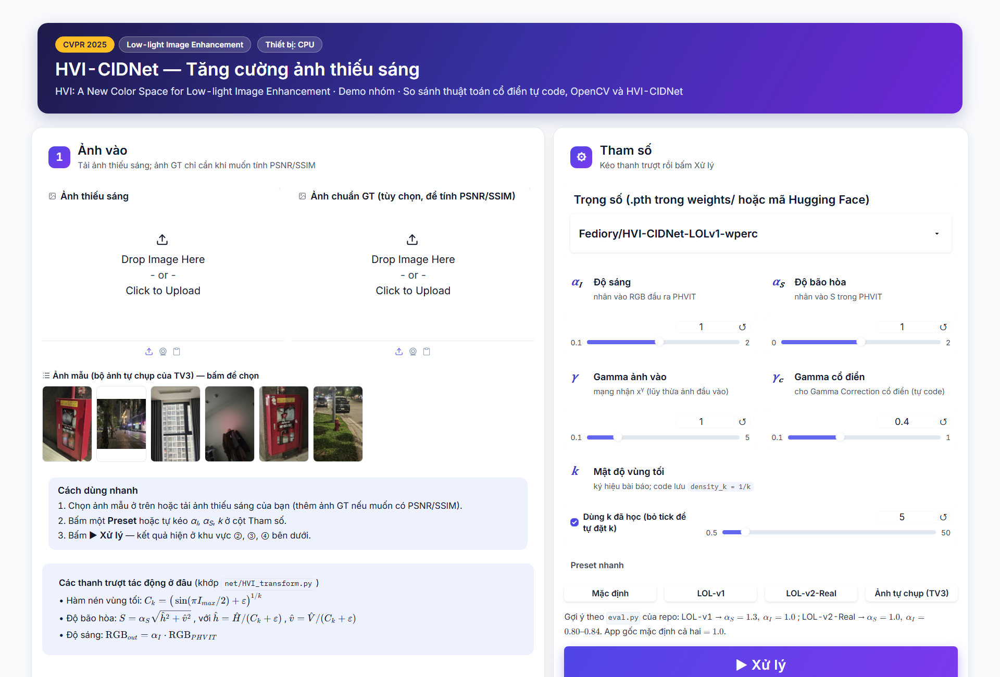
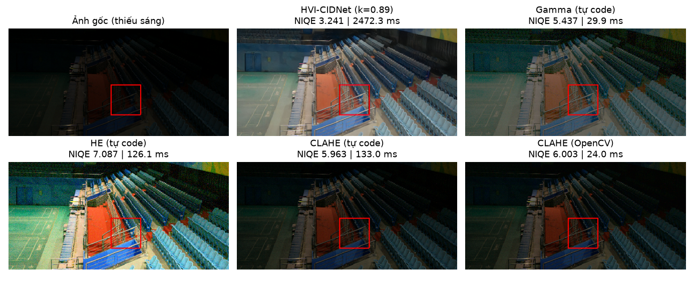
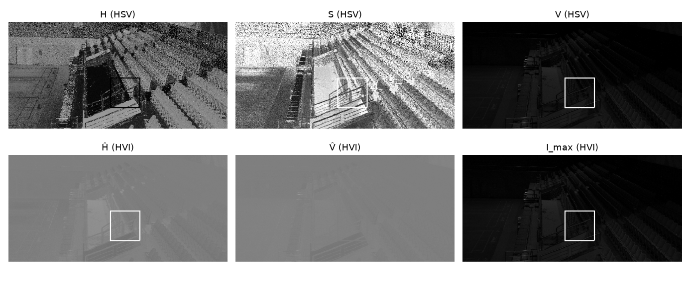
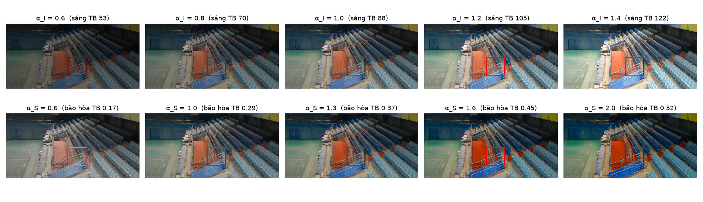
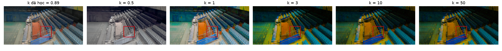

# Đồ Án Môn Học: Xử Lý Ảnh (INT13146)
**Học viện Công nghệ Bưu chính Viễn thông (PTIT) - Khoa CNTT 1**  
**Giảng viên hướng dẫn:** ThS/TS. Phạm Hoàng Việt  
**Đề tài:** `[CVPR'25] HVI: A New Color Space for Low-light Image Enhancement`  
**Bài báo gốc:** Yan et al., CVPR 2025 — [arXiv:2502.20272](https://arxiv.org/abs/2502.20272) | Mã nguồn gốc: [Fediory/HVI-CIDNet](https://github.com/Fediory/HVI-CIDNet)

---

## 📌 Phân công Chuyên môn: Thành viên 4 (25% đóng góp)
- **Nội dung:** Tích hợp pipeline suy luận HVI-CIDNet: tiền xử lý **Reflect Padding 8×8**, cắt ngưỡng **Clip Operation** (Mục 10.2), khai thác phép biến đổi ngược **PHVIT** (Công thức 6) để chỉnh trực tiếp độ sáng $\alpha_I$ và độ bão hòa $\alpha_S$.
- **Sản phẩm:** Giao diện Web Demo `app_demo.py` (Gradio) đặt cạnh nhau **thuật toán cổ điển tự code (TV1) ↔ OpenCV ↔ HVI-CIDNet**, kèm bảng PSNR / SSIM / NIQE / thời gian chạy và trực quan hóa kênh màu **HSV vs HVI**.

---

## 🚀 Các tính năng chính trong `app_demo.py`

### 1. Pipeline suy luận HVI-CIDNet
* **`reflect_pad8(x)` — Reflect Padding 8×8:** CIDNet có 3 tầng Downsampling (hệ số $2^3 = 8$) nên $H, W$ phải chia hết cho 8. Ảnh được đệm đối xứng (Reflect) ở cạnh **phải** và **dưới**, sau khi suy luận thì cắt về đúng kích thước gốc.
* **Clip Operation:** Ảnh đầu ra được kẹp `torch.clamp(y, 0, 1)` để loại giá trị ngoại lai trước khi đổi về `uint8`.
* **`run_cidnet(...)` — Điều khiển PHVIT (Công thức 6):**
  - $S = \alpha_S \cdot \sqrt{\hat{h}^2 + \hat{v}^2}$ → bật cờ `gated` và gán `alpha_s` trong lớp `RGB_HVI`.
  - $V = \alpha_I \cdot \hat{I}$ → bật cờ `gated2` và gán `alpha` (nhân vào ảnh RGB đầu ra PHVIT).
  - **Tham số mật độ $k$:** trong code lưu `density_k = 1/k`. App cho phép dùng $k$ đã học hoặc ghi đè $k$ tùy ý (minh họa Failure Case 2), sau đó **trả lại $k$ gốc** để không làm hỏng mô hình.
  - Đo thời gian suy luận chính xác (có `torch.cuda.synchronize()` khi chạy GPU).
* **`load_weights(path)`:** Nạp trọng số từ file `.pth` trong `weights/` **hoặc** mã Hugging Face (mặc định `Fediory/HVI-CIDNet-LOLv1-wperc`), có cache để không nạp lại.

### 2. Đối chứng thuật toán cổ điển
* **Tự code (TV1):** Gamma, HE, CLAHE gọi qua `enhance_classical_scratch(img, method, gamma)` trong `color_space_scratch.py` của [Thành viên 1](https://github.com/doccocaubai-20/XuLyAnh).
* **OpenCV:** `opencv_clahe()` dùng `cv2.createCLAHE` **cùng tham số** (clip = 2.0, lưới 8×8) và **cùng kênh V của HSV** với bản tự code để so sánh công bằng.
* **Chỉ số:** PSNR, SSIM (`skimage`, cần ảnh GT) và NIQE (không cần GT, dùng `loss/niqe_utils.py` của repo gốc).

### 3. Giao diện Web 4 khu vực (tối ưu cho trình chiếu)
| Khu vực | Nội dung |
| :--- | :--- |
| **①** Ảnh vào & tham số | Ảnh thiếu sáng + ảnh GT (tùy chọn); chọn trọng số, thanh trượt $\alpha_I$, $\alpha_S$, gamma, $k$, gamma cổ điển; gợi ý preset theo `eval.py` |
| **②** Ảnh gốc vs HVI-CIDNet | Hai ảnh lớn đặt cạnh nhau + bảng PSNR ↑, SSIM ↑, NIQE ↓, Thời gian (ms) |
| **③** Phương pháp cổ điển | Lưới 2×2: Gamma, HE, CLAHE tự code, CLAHE OpenCV |
| **④** Kênh màu | Hàng trên H, S, V (HSV) — hàng dưới $\hat{H}$, $\hat{V}$, $I_{max}$ (HVI) |



* **Bố cục dạng thẻ:** banner tiêu đề, mỗi khu vực là một thẻ có số thứ tự; khu vực ③ và ④ đặt cạnh nhau, cùng 2 hàng ảnh nên cao bằng nhau. Hỗ trợ cả giao diện sáng và tối.
* **Chữ dễ đọc khi trình chiếu:** phông Inter (đủ dấu tiếng Việt, chữ Hy Lạp, dấu mũ $\hat{H}$, $\hat{V}$), chữ 18px, tiêu đề 24px, bảng 20px.
* **Ký hiệu đúng chuẩn:** nhãn thanh trượt có chỉ số dưới ($\alpha_I$, $\alpha_S$, $\gamma$, $\gamma_c$, $k$); hộp công thức viết bằng LaTeX, khớp `net/HVI_transform.py`:
  $C_k = (\sin(\pi I_{max}/2) + \varepsilon)^{1/k}$; $S = \alpha_S\sqrt{\hat h^2 + \hat v^2}$ với $\hat h = \hat H/(C_k+\varepsilon)$, $\hat v = \hat V/(C_k+\varepsilon)$; $\mathrm{RGB}_{out} = \alpha_I \cdot \mathrm{RGB}_{\mathrm{PHVIT}}$.
* **Nút preset:** *Mặc định*, *LOL-v1*, *LOL-v2-Real*, *Ảnh tự chụp (TV3)* — đặt sẵn trọng số và $\alpha_I$, $\alpha_S$, gamma.
* **Phản hồi khi bấm Xử lý:** nút đổi thành "⏳ Đang xử lý…" và bị khóa; thanh trạng thái báo đang chạy → "✅ Xong sau X giây" hoặc "⚠ lỗi".
* **Ảnh mẫu bấm-là-chạy:** hiện khi có thư mục `test_tv3/input/` (ảnh tự chụp của TV3 đã cắt 3:2, cạnh dài 600 px); không có thư mục này app vẫn chạy bình thường.
* Tương thích **Gradio 4/5/6**: tự kiểm tra bằng `inspect.signature` để đặt `css`/`theme` ở `gr.Blocks(...)` hay `demo.launch(...)`, chỉ dùng `fill_width` nếu phiên bản có hỗ trợ.

| Thanh trượt | Khoảng | Mặc định | Ý nghĩa |
| :--- | :---: | :---: | :--- |
| $\alpha_I$ | 0.1 – 2.0 | 1.0 | Độ sáng (nhân vào RGB đầu ra PHVIT) |
| $\alpha_S$ | 0.0 – 2.0 | 1.0 | Độ bão hòa (nhân vào S trong PHVIT) |
| $\gamma$ (gamma ảnh vào) | 0.1 – 5.0 | 1.0 | Mạng nhận $x^{\gamma}$ (lũy thừa ảnh đầu vào) |
| $k$ | 0.5 – 50 | 5.0 | Mật độ vùng tối (chỉ dùng khi bỏ tick "Dùng k đã học"); code lưu `density_k = 1/k` |
| $\gamma_c$ (gamma cổ điển) | 0.1 – 1.0 | 0.4 | Gamma Correction tự code |

Gợi ý preset theo `eval.py` của repo gốc: **LOL-v1** → $\alpha_S = 1.3$, $\alpha_I = 1.0$; **LOL-v2-Real** → $\alpha_S = 1.0$, $\alpha_I = 0.80 – 0.84$.

---

## 📁 Cấu trúc & Cài đặt

Đặt `app_demo.py` vào **thư mục gốc** của repo [HVI-CIDNet](https://github.com/Fediory/HVI-CIDNet), cùng cấp với `net/`, `loss/`, `weights/`, kèm file `color_space_scratch.py` của Thành viên 1:

```text
HVI-CIDNet/
├── net/                     # CIDNet, HVI_transform, LCA (repo gốc)
├── loss/niqe_utils.py       # NIQE (repo gốc)
├── weights/                 # (tùy chọn) file .pth tải từ README repo gốc
├── color_space_scratch.py   # Thành viên 1
└── app_demo.py              # Thành viên 4
```

```bash
pip install torch torchvision gradio opencv-python scikit-image pillow numpy scipy
pip install einops huggingface_hub safetensors matplotlib
```

> Nếu thiếu `color_space_scratch.py`, app vẫn chạy bằng bản tạm và dòng ghi chú sẽ cảnh báo *"BẢN TẠM trong app_demo.py…"*.

## ▶️ Cách chạy

```bash
python app_demo.py              # dùng GPU nếu có
python app_demo.py --cpu        # ép chạy CPU
python app_demo.py --port 7861  # đổi cổng (mặc định 7860)
```

Mở `http://127.0.0.1:7860`, tải ảnh thiếu sáng (và ảnh GT nếu muốn tính PSNR/SSIM), chỉnh thanh trượt rồi bấm **Xử lý**. Lần chạy đầu cần Internet để tải trọng số từ Hugging Face.

---

## 📊 Kết quả kiểm thử

### 1. Reflect Padding 8×8 + Clip Operation
Kiểm tra với ảnh có kích thước không chia hết cho 8 — đầu ra luôn đúng kích thước gốc và nằm trong $[0, 255]$:

| Ảnh vào (H×W) | Sau Reflect Padding | Ảnh ra | Khoảng giá trị ra |
| :---: | :---: | :---: | :---: |
| 400 × 600 | 400 × 600 | 400 × 600 | [0, 255] |
| 401 × 601 | 408 × 608 | 401 × 601 | [0, 255] |
| 123 × 457 | 128 × 464 | 123 × 457 | [0, 255] |
| 517 × 389 | 520 × 392 | 517 × 389 | [0, 255] |

### 2. So sánh phương pháp (CPU, trọng số `Fediory/HVI-CIDNet-LOLv1-wperc`)
Không có ảnh GT nên chỉ đo NIQE (↓ càng thấp càng tự nhiên). Số liệu đầy đủ: `output_member4/metrics_member4.csv`.

| Phương pháp | NIQE ↓ (LOL-v1) | NIQE ↓ (LOL-v2) | Thời gian (ms, LOL-v1) |
| :--- | :---: | :---: | :---: |
| Gamma (tự code, γ = 0.4) | 5.437 | 5.165 | 29.9 |
| HE (tự code) | 7.087 | 6.406 | 126.1 |
| CLAHE (tự code) | 5.963 | 5.397 | 133.0 |
| CLAHE (OpenCV) | 6.003 | 5.332 | 24.0 |
| **HVI-CIDNet** ($k$ đã học = 0.89) | **3.241** | **3.817** | 2472.3 |

> Thời gian HVI-CIDNet đo trên **CPU**; trên GPU nhanh hơn nhiều (bài báo báo cáo ~0.053 s/ảnh).

### 3. Ảnh thực nghiệm (Thư mục `output_member4/`)
* `compare_lolv1.png`, `compare_lolv2.png`: Ảnh gốc vs HVI-CIDNet vs Gamma / HE / CLAHE tự code / CLAHE OpenCV.
* `channels_hsv_vs_hvi.png`: Kênh H, S, V của HSV so với $\hat{H}$, $\hat{V}$, $I_{max}$ của HVI.
* `alpha_sweep.png`: Ảnh hưởng của $\alpha_I \in \{0.6 … 1.4\}$ (độ sáng TB 53 → 122) và $\alpha_S \in \{0.6 … 2.0\}$ (độ bão hòa TB 0.17 → 0.52).
* `k_sweep.png`: Ghi đè $k \in \{0.5, 1, 3, 10, 50\}$ so với $k$ đã học — $k$ nhỏ làm ảnh mất màu, $k \ge 3$ gây ám vàng và nhiễu màu (**Failure Case 2**).
* `input_lolv1.png`, `input_lolv2.png`: Ảnh vào (cắt từ cột ảnh thiếu sáng trong hình `pic/LOL.png` của repo gốc; khung đỏ/vàng là chú thích có sẵn của hình).






---

## 🔗 Liên kết các thành viên
* Thành viên 1 — Không gian màu HVI & thuật toán cổ điển tự code: [doccocaubai-20/XuLyAnh](https://github.com/doccocaubai-20/XuLyAnh)
* Thành viên 2 — Kiến trúc CIDNet & trực quan hóa đặc trưng: [LUan5626/XuLyAnh_TV2](https://github.com/LUan5626/XuLyAnh_TV2)
* Thành viên 4 — Tích hợp pipeline & Web Demo: repo này

## 📝 Phạm vi thực hiện
Nội dung repo thuộc phần công việc **Thành viên 4**: tích hợp pipeline (Reflect Padding 8×8, Clip Operation, điều khiển $\alpha_I$, $\alpha_S$, $k$ trong PHVIT) và xây dựng giao diện Web Demo để trình chiếu, so sánh trực quan thuật toán tự code, OpenCV và HVI-CIDNet. Các module mạng (`net/`, `loss/`) thuộc repo gốc [Fediory/HVI-CIDNet](https://github.com/Fediory/HVI-CIDNet) và không được sao chép vào đây.
